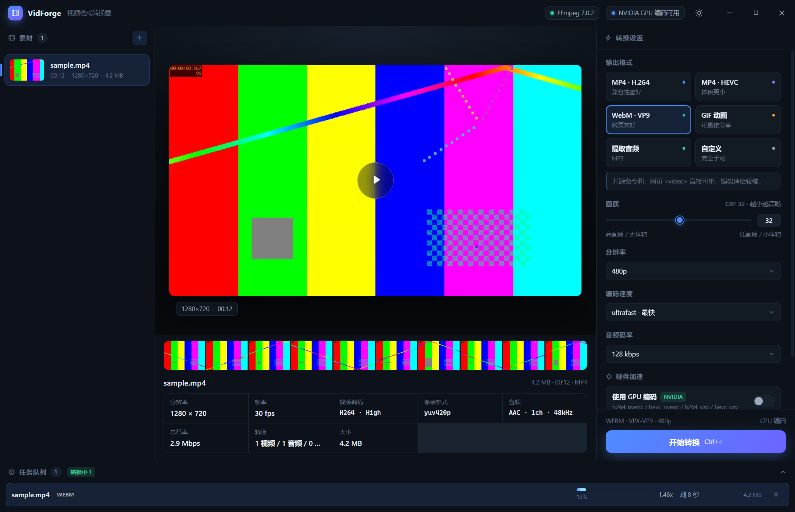

# VidForge — 桌面视频格式转换器

一个基于 **Electron + React + FFmpeg 命令行** 的桌面视频格式转换工具。为真人设计：导入视频即见信息与缩略图，选预设一键转换，全程进度可视、可取消、可批量。



## 功能

**核心要求**

- ✅ 加载视频并显示完整媒体信息（容器 / 分辨率 / 帧率 / 编码 / 像素格式 / 音轨 / 码率 / 轨道数）
- ✅ 自动提取缩略图：单张"代表性帧"海报 + 10 帧时间轴胶片条（悬停显示时间点，可点击跳转预览）
- ✅ 转换通过 FFmpeg 命令行完成（`spawn` 子进程，未使用 FFmpeg API/库绑定）

**自选优化**

| 优化 | 说明 |
| --- | --- |
| 硬件加速自动探测 | 启动时对 NVENC / QSV / AMF / VideoToolbox 逐一做 0.2s 真实试编码（列出编码器≠能用），结果缓存 24h；UI 开关控制，失败自动降级软件编码重试 |
| 6 组开箱预设 | MP4·H.264（通用）/ MP4·HEVC（省 30%~50% 体积）/ WebM·VP9（网页友好）/ GIF（双段调色板量化）/ MP3 提取 / 自定义 |
| 精准进度 | `-progress pipe:1` 结构化解析，显示百分比、实时速度、剩余时间估算（ETA），120ms 节流刷新 |
| 串行任务队列 | 批量导入按队列执行，避免多路并发转码拖垮机器；支持取消（Windows 下 taskkill 进程树）、清除已完成 |
| 输出体积对比 | 完成后显示 输出大小 与 相对源文件的压缩率（↓32% / ↑15%） |
| 缩略图缓存 | 按 路径+大小+时长 哈希缓存到 userData，二次打开秒出图 |
| 时间轴胶片 | 单次 ffmpeg 调用 `fps+scale+tile` 生成一帧拼图，渲染端 CSS 切片，零额外请求 |
| 友好错误 | ffmpeg stderr 翻译成人话（"磁盘空间不足"/"文件已损坏"/"没有写入权限"…） |
| 客户级交互 | 无边框自绘标题栏、全窗拖拽导入、Ctrl+O / Ctrl+Enter 快捷键、Toast 通知、暗/亮主题、输出目录自定义、防覆盖命名 `name (1).mp4` |

## 技术栈

- **Electron 45** + **React 19** + **TypeScript 5.7** + **Vite 6**
- 渲染进程零运行时依赖（无 UI 库，设计系统手写 CSS）
- `contextIsolation + preload` 白名单 IPC；自定义 `vf://` 协议（手写 Range 支持）安全地流式访问本地媒体与缩略图，全程不关闭 webSecurity

## 快速开始

前置：Node.js ≥ 20；FFmpeg（二选一）

1. 已安装 FFmpeg 并在 PATH 中，或
2. 将 `ffmpeg.exe` / `ffprobe.exe` 放入项目 `bin/` 目录（打包时随应用分发，用户机器无需安装）

```bash
npm install
npm start        # 构建并启动
npm run dist     # 打包 Windows 安装包 + 便携版（electron-builder）
```

### 使用指南（30 秒上手）

1. **导入**：把视频文件直接拖进窗口，或点左上角「添加文件」（快捷键 `Ctrl+O`）
2. **查看**：左侧素材列表选中后，中间显示播放预览、10 帧时间轴胶片与完整媒体信息
3. **设置**：右侧选择输出格式（MP4 / HEVC / WebM / GIF / MP3）、分辨率、质量；高级区可开关硬件加速、指定输出目录
4. **转换**：点底部「开始转换」（当前文件，`Ctrl+Enter`）或「转换全部」；底部队列实时显示进度、速度与剩余时间，可随时取消
5. **取件**：完成后点队列条目上的「打开文件夹」直达输出文件；列表中会显示输出体积与压缩率

## 项目结构

```
electron/                 主进程
  main.ts                 窗口 / IPC / vf:// 协议 / 自测入口
  preload.ts              contextBridge 白名单 API
  services/
    ffmpeg.ts             二进制定位 / spawn / 进度管道 / 进程树查杀
    probe.ts              ffprobe JSON 解析 → MediaInfo
    thumbnails.ts         海报帧(thumbnail 滤镜) + 胶片条(fps+tile)
    converter.ts          预设 → argv 构建器 / 串行队列 / 硬件降级
    hardware.ts           GPU 编码器真实试编码探测
shared/                   主/渲染进程共享类型与预设数据
src/                      React 渲染进程（组件 + 手写设计系统）
scripts/                  （预留）核心链路测试
test-media/               演示素材（可删除）
```

## 自测

```bash
npm run build && electron . --selftest
```

无头跑通 probe → 缩略图 → 4 种预设转换（MP4/GIF/MP3/VP9），结果写入 `test-results.json`。最近一次结果：4/4 通过，12s 720p 源，总耗时 12.3s。

## 文档

- [`docs/SESSION_SUMMARY.md`](docs/SESSION_SUMMARY.md) —— 开发会话总结：需求解读、9 项关键技术决策（含备选与取舍）、9 个问题的根因与修复、来自人的反馈及调整、测试证据、下一步计划

## 已知限制

- HEVC/AV1 等 Chromium 不支持的容器内无法直接预览播放，此时显示代表性帧海报（转换不受影响）
- GIF 转换为固定 15fps / 最长按源分辨率缩放，长视频建议先降分辨率
- macOS 未签名，首次打开需右键 → 打开
